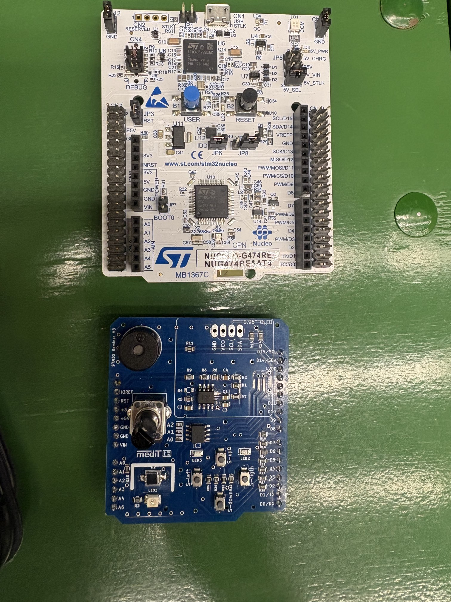
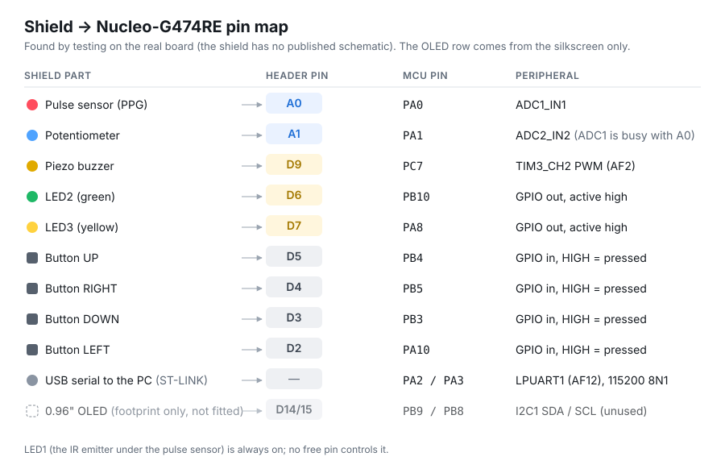
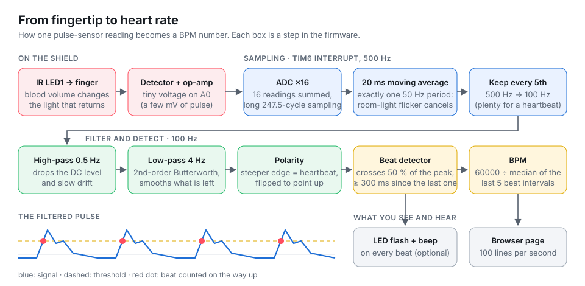
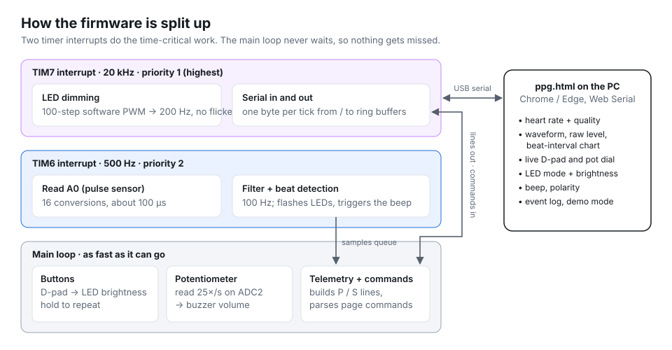

# STMBoard2

Firmware and a browser dashboard for a NUCLEO-G474RE board with a blue mediT "STM32 Seminar V3" shield. The board reads a fingertip pulse sensor, works out heart rate, and streams everything to a web page over USB. The page also shows the shield's buttons, potentiometer, LEDs and buzzer, and lets you control the LEDs and buzzer.



## What it does

- Measures heart rate with the shield's optical pulse sensor (a PPG: an infrared LED shines into your fingertip and a detector picks up the small changes in reflected light with each heartbeat).
- Shows BPM, signal quality, the live waveform, beat-to-beat intervals and two heart rate variability numbers (SDNN and RMSSD) in the browser.
- Flashes the LEDs and, if you turn it on, beeps on every heartbeat.
- The D-pad sets LED brightness and the potentiometer sets buzzer volume.
- Works with a demo mode, so you can try the page without the board plugged in.

## Hardware

| | |
|---|---|
| MCU board | [NUCLEO-G474RE](https://www.st.com/en/evaluation-tools/nucleo-g474re.html) (STM32G474RE, Cortex-M4F at 170 MHz) |
| Board manual | [UM2505, STM32G4 Nucleo-64 boards](https://www.st.com/resource/en/user_manual/um2505-stm32g4-nucleo64-boards-mb1367-stmicroelectronics.pdf). The header pinouts (the D0 to D15 and A0 to A5 labels, plus the full morpho connectors) are in its connector tables. |
| Shield | mediT "STM32 Seminar V3". I couldn't find a schematic or any documentation online, so the pin map below comes from testing each part on the real board. |
| IDE | STM32CubeIDE 2.3.0, plus standalone STM32CubeMX 6.19.0 for the `.ioc` file |

The shield plugs into the Nucleo's headers, whose pins are labelled D0 to D15 and A0 to A5. Each label is just a name for one STM32 pin (D9 is PC7, A0 is PA0, and so on), and the firmware only uses the STM32 names.



A few things that took a while to find out:

- A0 is the pulse sensor and A1 is the potentiometer. A2 to A5 aren't connected to anything on the shield.
- The buzzer is on D9 (PC7, TIM3 channel 2), not D10.
- Every D-pad button reads HIGH when pressed.
- LED1, the infrared emitter under the pulse sensor, is always on. You can barely see it by eye, but a phone camera shows it clearly.
- The 0.96" OLED outline on the shield is only a footprint. No display is fitted.

## How the pulse reading works



The raw pulse is only a few millivolts riding on a large DC level, and room lighting flickers at 50 Hz on top of it. The firmware deals with this in steps:

1. Sample A0 at 500 Hz, summing 16 ADC conversions each time with a long sampling time.
2. Average the last 10 samples. That window is 20 ms, exactly one mains period, so 50 Hz flicker and its harmonics cancel out. Then keep every 5th sample, which gives 100 Hz.
3. A 0.5 Hz high-pass removes the DC level and slow drift from finger pressure and breathing. A 4 Hz low-pass (2nd-order Butterworth) smooths the rest. A resting heart rate sits between about 0.7 and 3.3 Hz, so both edges leave it untouched.
4. The sensor's output may come out upside down. The steep edge of each pulse is the heartbeat itself, so the firmware checks which slope direction is steeper and flips the signal to make that edge point up. You can also force the polarity from the page.
5. A beat counts when the signal rises through half of its recent peak, after dipping below zero, at least 300 ms after the previous beat (200 BPM at most).
6. BPM is 60000 divided by the median of the last five beat intervals, so a single missed or extra beat doesn't throw it off. If no beat comes for 3 seconds, the reading clears.

## Firmware structure



Two timer interrupts handle anything with strict timing:

- TIM7 runs at 20 kHz with the highest priority. It dims the LEDs with a 100-step software PWM (200 Hz, no visible flicker) and moves one byte in or out of the serial ring buffers per tick.
- TIM6 runs at 500 Hz. It reads A0 (about 100 µs per burst), runs the filters and beat detector, and queues each 100 Hz result.

The main loop reads the buttons and the potentiometer, turns queued samples into text lines and parses commands from the page. It never waits on the serial port, so commands from the page aren't lost while the board is sending data.

The potentiometer is read on ADC2. PA1 connects to both ADC1 and ADC2, and ADC1 is busy with the pulse sensor.

All of the application code is in [`Core/Src/main.c`](Core/Src/main.c).

## Getting started

1. Open the project in STM32CubeIDE, build it, and flash it to the board through the Nucleo's ST-LINK.
2. Close PuTTY or anything else using the board's COM port. Only one program can hold it at a time.
3. Open [`Claude/ppg.html`](Claude/ppg.html) in Chrome or Edge. Firefox has no Web Serial support.
4. Click Connect and pick the STLink port. If the status stays on "waiting for data", press the black reset button on the Nucleo.
5. Rest a fingertip over LED1 and the square sensor above it. Use light, steady pressure, keep still, and shade it from bright room light.

To look at the page without the board, click Demo. It generates a fake pulse, random button presses and a sweeping potentiometer.

## Controls

| Control | What it does |
|---|---|
| UP / DOWN | LED2 (green) brightness +10 / -10 % |
| RIGHT / LEFT | LED3 (yellow) brightness +10 / -10 % |
| Hold a D-pad key | Repeats, first after 450 ms, then every 150 ms. The LED lights for 0.6 s so you can see the new level. |
| Page: Buzzer button | Beep on every heartbeat, on or off |
| Potentiometer | Buzzer volume, from silent to loudest. A short beep plays at each new level. |
| Page: LED mode | Off, On, or Beat (flashes on each heartbeat) |
| Page: brightness sliders | 0 to 100 %. Both LEDs start at 10 %. |
| Page: Polarity | Auto, normal or inverted |

Brightness follows a squared curve (duty = s × s / 100) to give finer steps at the dim end. That makes 10 % on the slider quite faint.

## Serial protocol

115200 baud, 8N1, over the ST-LINK virtual COM port. Lines starting with `#` are comments.

Board to PC, 100 lines per second:

```
P,ms,raw,filt,thr,bpm10,beat,ibi,q,pol,btn,l2,l3
```

| Field | Meaning |
|---|---|
| raw | 12-bit ADC value ×16, after the 50 Hz filter |
| filt, thr | filtered signal and beat threshold, ×100 |
| bpm10 | heart rate ×10, 0 when there is none |
| beat, ibi | 1 on a detected beat, with its interval in ms |
| q | 0 no pulse, 1 saturated, 2 searching, 3 good, 4 irregular |
| pol | +1 or -1, the polarity in use |
| btn | bit 0 LEFT, 1 DOWN, 2 RIGHT, 3 UP |
| l2, l3 | whether each LED is lit right now |

Board to PC, 10 lines per second:

```
S,ms,pot,polmode,beep,m2,m3,s2,s3,vol
```

`pot` is 0 to 4095. `polmode` is 0 auto, 1 normal, -1 inverted. `m2` and `m3` are the LED modes (0 off, 1 on, 2 beat). `s2` and `s3` are brightness from 0 to 100. `vol` is buzzer duty from 0 to 50 %, where 50 is loudest.

PC to board, one command per line:

| Command | Effect |
|---|---|
| `i` | cycle polarity: auto, normal, inverted |
| `b` | beep on or off |
| `2m0` / `2m1` / `2m2` | LED2 off / on / beat (`3m` for LED3) |
| `2:NN` / `3:NN` | LED2 / LED3 brightness, 0 to 100 |

## Repository layout

| Path | Contents |
|---|---|
| `Core/Src/main.c` | All application code |
| `Claude/ppg.html` | The dashboard |
| `Claude/STM32_board_notes.md` | Detailed lab notes: pin hunting, peripheral settings, everything tried so far, and fixes for problems along the way |
| `Claude/*.c.bak` | Earlier programs (debug platform, analog finder, PPG only). They end in `.bak` so CubeIDE won't compile them. To use one, copy it over `Core/Src/main.c` and remove `.bak` from the name. |
| `Claude/debug.html`, `analog_finder.html`, `pulse_plot.html` | Pages that go with the earlier programs |
| `docs/` | Diagrams and the board photo |
| `Drivers/`, `Core/Inc`, `*.ioc`, `*.ld` | CubeMX-generated HAL, CMSIS, BSP and linker files |

`main.c` has no `USER CODE` markers. If you regenerate code from the `.ioc` in CubeMX, it will overwrite `main.c`, so make a copy first.

## Troubleshooting

| Problem | Fix |
|---|---|
| COM port busy when flashing or connecting | PuTTY or another browser tab is holding it. Close it. |
| Page connects but shows no data | Wrong firmware on the board, wrong port picked, or the board needs a reset press. |
| Build fails with "multiple definition of main" | A second `.c` file with a `main()` is inside the project. Rename it to `.bak`, then Refresh and Clean in CubeIDE. |
| "No pulse" or "Irregular" | Cover LED1 and the sensor completely, press lightly (pressing hard blocks blood flow), keep still and shade the sensor. If the waveform clearly shows pulses but no beats are counted, lower `AMP_MIN` in `main.c`. |
| "Saturated" | The ADC is at its limit. Press more lightly or block strong light. |
